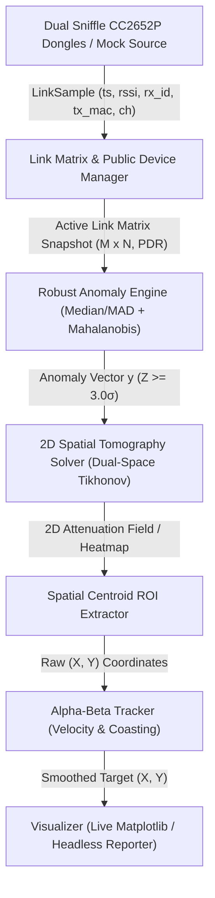

# 2D Radio Tomographic Sensing Engine

The **2D Radio Tomographic Sensing Engine** in AirTell ([`radar_tomography.py`](src/airtell/scripts/radar_tomography.py) and the [`sniffle.radar`](src/sniffle/src/sniffle/radar/__init__.py) package) is a passive, device-free radio frequency (RF) imaging and human localization system. It measures Received Signal Strength Indication (RSSI) perturbations across RF chords between ambient Bluetooth Low Energy (BLE) transmitters and distributed Sniffle receivers to image physical movements and track occupants without requiring them to carry any electronic device.

---

## 1. High-Level Pipeline Architecture

The engine is structured as an end-to-end, multi-stage processing pipeline:

---

## 2. Core Functional Layers & Components

### Layer 1: Hardware Ingestion & Channel Locking ([`capture.py`](src/sniffle/src/sniffle/radar/capture.py))

* **Dual Receiver Diversity ([`DualSnifferManager`](src/sniffle/src/sniffle/radar/capture.py#L31)):** Coordinates two physical Texas Instruments CC2652P USB dongles running Sniffle firmware ([`HardwareSniffleSource`](src/sniffle/src/sniffle/radar/capture.py#L8)).
* **Fixed-Channel Locking:** Locks Receiver 1 (`R1`) to BLE advertising Channel 37 and Receiver 2 (`R2`) to Channel 38 (or 39). Locking avoids frequency-hopping errors and captures channel-specific multipath behavior.
* **Physics-Based Simulation ([`MockSniffleSource`](src/sniffle/src/sniffle/radar/capture.py#L310)):** When hardware is absent or `--simulate` is specified, simulates 14+ ambient BLE transmitters across a 20m $\times$ 10m room using log-distance path loss ($n=2.2$), multipath noise, and human walking trajectories ([`default_human_trajectory`](src/sniffle/src/sniffle/radar/capture.py#L273)). Computes Euclidean chord distance via [`point_to_segment_distance`](src/sniffle/src/sniffle/radar/capture.py#L280) to introduce realistic $>3\sigma$ attenuation drops and packet losses.
* **Immutable Packet Unit ([`LinkSample`](src/sniffle/src/sniffle/radar/capture.py#L53)):** Represents over-the-air BLE packets containing `timestamp`, `rssi`, `rx_id`, `tx_mac`, and `channel`.

### Layer 2: Ambient Link Lifecycle & $M \times N$ Matrix Management ([`matrix.py`](src/sniffle/src/sniffle/radar/matrix.py))

* **MAC Address Classification ([`classify_ble_mac`](src/sniffle/src/sniffle/radar/matrix.py#L37)):** Inspects the PDU `TxAdd` header bit and MSB bits to categorize devices into [`AddressType`](src/sniffle/src/sniffle/radar/matrix.py#L30): `Public`, `Random_Static`, `Random_RPA` (Resolvable Private Address), and `Random_NRPA`.
* **5-Stage Link Lifecycle ([`LinkState`](src/sniffle/src/sniffle/radar/matrix.py#L66)):** Transitions links through:
  1. `DISCOVERING` &mdash; Initial packet observation and advertising interval learning.
  2. `ACTIVE` &mdash; Activated after meeting `min_activation_pkts` (default 3 packets).
  3. `DEGRADED` &mdash; Triggered after occlusion timeout ($>3.0\text{ s}$).
  4. `STALE` &mdash; Triggered when unobserved for $>15.0\text{ s}$.
  5. `PRUNED` &mdash; Automated removal when unobserved for $>30.0\text{ s}$ (`--mac-timeout`).
* **RF Sensing Guardrails ([`\_update_link_features`](src/sniffle/src/sniffle/radar/matrix.py#L211)):** Calculates activity scores considering:
  - **Attenuation Drop:** $\max(0, \text{baseline} - \text{mean\_rssi})$.
  - **Multipath Reflection Boost:** $0.6 \times \max(0, \text{mean\_rssi} - \text{baseline})$.
  - **Turbulence / Variance Spike:** $1.5 \times \max(0, \sigma - 1.0)$.
  - **Packet Delivery Rate (PDR) Penalty:** $(1.0 - \text{PDR}) \times 15.0\text{ dB}$.
* **Ambient Discovery ([`PublicDeviceManager`](src/sniffle/src/sniffle/radar/matrix.py#L314)):** Deterministically places discovered ambient devices into the 2D coordinate plane bounded by room dimensions.

### Layer 3: Robust Anomaly Detection Engine ([`anomaly.py`](src/sniffle/src/sniffle/radar/anomaly.py))

* **Robust Z-Score ([`compute_link_robust_z`](src/sniffle/src/sniffle/radar/anomaly.py#L92)):** Uses median and Median Absolute Deviation (MAD) rather than mean/standard deviation to reject impulsive RF bursts: $$Z_{\text{robust}} = 0.6745 \cdot \frac{|x - \text{median}|}{\text{MAD}_{\text{eff}}}\$$
  Enforces a noise floor of $\text{MAD}_{\text{eff}} \ge 0.5\text{ dBm}$. Appends a PDR drop penalty up to $6.0\sigma$.
* **Multivariate Mahalanobis Distance ([`compute_mahalanobis_anomaly`](src/sniffle/src/sniffle/radar/anomaly.py#L130)):** Computes spatial covariance across all $K$ active links:
  $$D_M(x) = \sqrt{(x - \mu)^T \Sigma_{\text{reg}}^{-1} (x - \mu)}$$
  Applies Ledoit-Wolf-style covariance shrinkage / diagonal loading ($\Sigma_{\text{reg}} = S + \gamma I$) to guarantee non-singular inversions when $N < K$.
* **Wilson-Hilferty Transformation ([`compute_wilson_hilferty`](src/sniffle/src/sniffle/radar/anomaly.py#L20)):** Transforms the $\chi^2$-distributed squared Mahalanobis distance $D_M^2$ (with $K$ degrees of freedom) into an equivalent standard normal score $Z_M$:
  $$Z_M = \frac{(D_M^2 / K)^{1/3} - (1 - \frac{2}{9K})}{\sqrt{\frac{2}{9K}}}$$
* **Selective Baseline Freezing:** When anomaly intensity exceeds $Z_M \ge 3.0\sigma$, background baseline history updates are suspended to prevent stationary or moving humans from corrupting the idle RF baseline.

### Layer 4: 2D Spatial Tomography ([`tomography.py`](src/sniffle/src/sniffle/radar/tomography.py))

* **1st Fresnel Zone Elliptical Kernel ([`update_geometry`](src/sniffle/src/sniffle/radar/tomography.py#L69)):** Precomputes sensitivity weight matrix $W \in \mathbb{R}^{K \times P}$ over $P$ grid voxels (default $100 \times 50 = 5000$ cells for a 20m $\times$ 10m room at 0.2m resolution):
  $$\text{excess} = (d_1 + d_2) - d_0$$
  $$W_{ij} = \frac{1}{\sqrt{\text{excess} + \epsilon}} \quad \text{for } \text{excess} \le \lambda_{\text{eff}}$$
  Each row is normalized such that $\sum_j W_{ij} = 1.0$, with zero weight outside the ellipse.
* **Dual-Space Tikhonov Regularization ([`solve_attenuation_field`](src/sniffle/src/sniffle/radar/tomography.py#L106)):** Inverts the linear model $y = Wx$ using dual-space formulation:
  $$x = \max\left(0, \; W^T (W W^T + \alpha I)^{-1} y\right)$$
  Inverting the $K \times K$ Gram matrix $(W W^T + \alpha I)$ instead of the $P \times P$ voxel covariance matrix yields solve latencies under $2\text{ ms}$, enabling real-time operation.
* **Centroid ROI Target Extraction ([`estimate_target_position`](src/sniffle/src/sniffle/radar/tomography.py#L119)):** Locates human targets by calculating the spatial center-of-mass across voxels above the 93rd percentile of the attenuation field, bounded by room dimensions.

### Layer 5: Dynamic Target Tracking ([`tracker.py`](src/sniffle/src/sniffle/radar/tracker.py) & [`TargetTracker`](src/sniffle/src/sniffle/radar/tomography.py#L167))

* **Alpha-Beta Filter:** Two-state filtering ($\alpha = 0.65, \beta = 0.15$) tracks target position $(x, y)$ and estimates velocity $(\dot{x}, \dot{y})$ to eliminate single-frame RF multipath jitter.
* **Blindspot Coasting:** If line-of-sight occlusion or packet loss temporarily prevents detection ($z = \text{None}$), the filter coasts the target forward along its existing velocity vector ($x_{k+1} = x_k + v_k \Delta t$).

### Layer 6: Visualizer & Headless Orchestrator ([`visualizer.py`](src/sniffle/src/sniffle/radar/visualizer.py))

* **Matplotlib GUI Display ([`RadarVisualizer`](src/sniffle/src/sniffle/radar/visualizer.py#L60)):** Renders room boundaries, receiver positions, transmitter nodes, active RF sensing chords, 2D attenuation heatmap (`viridis` / `inferno`), target marker, and historical motion trails.
* **Headless Pipeline Runner ([`RadarFrameProcessor`](src/sniffle/src/sniffle/radar/visualizer.py#L230) & [`run_single_frame`](src/sniffle/src/sniffle/radar/visualizer.py#L394)):** Supports non-GUI continuous integration testing and headless batch evaluation of recorded captures.

---

## 3. CLI Operation & Modes ([`radar_tomography.py`](src/airtell/scripts/radar_tomography.py))

The engine provides three operational modes:

| Mode | Command Example | Use Case |
| :--- | :--- | :--- |
| **In-Memory Simulation** | `python3 scripts/radar_tomography.py --simulate --headless --max-frames 25` | CI/CD testing, algorithmic verification without dongles. |
| **JSON Dataset Replay** | `python3 scripts/radar_tomography.py --replay data/radar_sample_data.json --headless` | Offline validation against recorded test sessions. |
| **Live Dual-Dongle Hardware** | `python3 scripts/radar_tomography.py --port1 /dev/ttyUSB0 --port2 /dev/ttyUSB1 --chan1 37 --chan2 38 --public-mode` | Physical deployment for real-time room tracking. |

### CLI Options Reference

| Flag | Type / Default | Description |
| :--- | :--- | :--- |
| `--simulate` | Flag (`False`) | Executes 2D indoor RF sensing simulation using synthetic emitters. |
| `--replay <file>` | Path | Replays recorded JSON RSSI session stream (e.g. `data/radar_sample_data.json`). |
| `--headless` | Flag (`False`) | Disables interactive Matplotlib rendering (uses `Agg` backend). |
| `--public-mode` | Flag (`True`) | Automatically discovers and tracks ambient public BLE devices over the air. |
| `--port1`, `--port2` | Path (`/dev/ttyUSB0`, `/dev/ttyUSB1`) | Serial port interfaces for Sniffle Receivers 1 and 2. |
| `--chan1`, `--chan2` | `37, 38, 39` (`37`, `38`) | Fixed advertising channels assigned to R1 and R2. |
| `--baud` | Integer (`921600`) | Serial UART baud rate for Sniffle hardware communication. |
| `--room-width` | Float (`20.0`) | Room width dimension along the X-axis in meters. |
| `--room-height` | Float (`10.0`) | Room height dimension along the Y-axis in meters (alias: `--room-length`). |
| `--grid-res` | Float (`0.2`) | Discretized voxel cell size in meters. |
| `--alpha-reg` | Float (`0.05`) | Covariance shrinkage regularization factor for Mahalanobis calculation. |
| `--mac-timeout` | Float (`30.0`) | Inactivity timeout in seconds before stale/rotated MACs are pruned. |
| `--threshold` | Float (`92.0`) | Disturbance percentile threshold for target centroid extraction. |
| `--max-frames` | Integer (`None`) | Automatically exits after processing $N$ frames (useful for test suites). |

---

## 4. Verification and Test Suite

The tomographic sensing engine is tested under the automated test suite:

- **Algorithm & Signal Tests:** [`test_radar_signal.py`](src/airtell/scripts/test_radar_signal.py), [`test_radar_tomography.py`](src/airtell/scripts/test_radar_tomography.py)
- **Public Device & Lifecycle Tests:** [`test_radar_public.py`](src/airtell/scripts/test_radar_public.py)
- **CLI & Integration Tests:** [`test_radar_cli.py`](src/airtell/scripts/test_radar_cli.py)
- **Tier 1 Feature Specifications (F1–F17):** [`test_tier1_features.py`](src/sniffle/src/sniffle/tests/test_tier1_features.py#L78-L1021)
