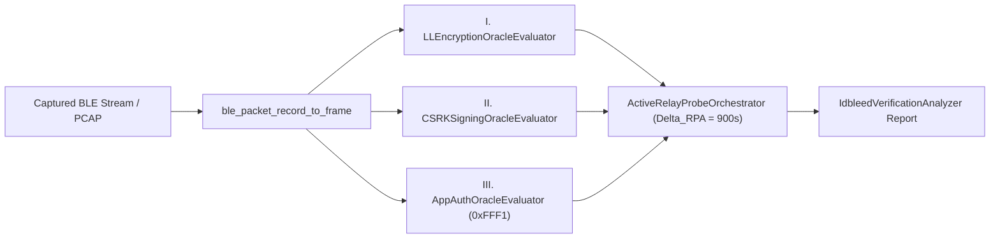
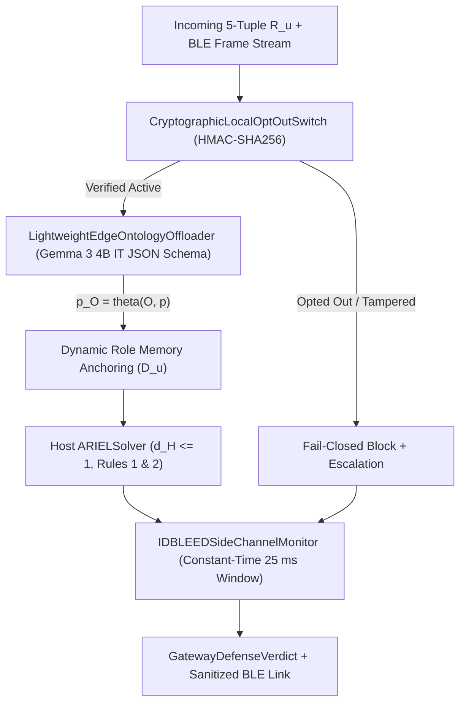

# System architecture blueprint for ARIEL privacy entailment and IDBLEED link-layer defense

This document specifies the integrated privacy and protocol hardening architecture in AirTell (`src/airtell/ariel/`, `src/airtell/sidechannel/idbleed_spec.py`, and `src/airtell/defense/`). It unifies Contextual Integrity (CI) neurosymbolic logical entailment at the software agent layer with constant-time Bluetooth Low Energy (BLE) link-layer side-channel suppression at the radio controller boundary.

## Table of contents

* [1. Executive overview and problem formulation](#1-executive-overview-and-problem-formulation)
  * [Core requirements for personalized privacy agents](#core-requirements-for-personalized-privacy-agents)
  * [Formal decision problem](#formal-decision-problem)
  * [Paradigm comparison](#paradigm-comparison)
  * [BLE link-layer side-channel threat model](#ble-link-layer-side-channel-threat-model)
* [2. ARIEL neurosymbolic logical entailment pipeline](#2-ariel-neurosymbolic-logical-entailment-pipeline)
  * [Contextual Integrity 5-tuple domain mappings](#contextual-integrity-5-tuple-domain-mappings)
  * [Formal partial order and entailment rules](#formal-partial-order-and-entailment-rules)
  * [Online phase Algorithm 1](#online-phase-algorithm-1)
  * [Mathematical soundness of the single-parameter neighborhood](#mathematical-soundness-of-the-single-parameter-neighborhood)
  * [Model backbone benchmark and memory scaling ablation](#model-backbone-benchmark-and-memory-scaling-ablation)
* [3. IDBLEED link-layer verification pipeline](#3-idbleed-link-layer-verification-pipeline)
  * [Feature set I: Link-layer encryption handshake oracle](#feature-set-i-link-layer-encryption-handshake-oracle)
  * [Feature set II: CSRK 64-bit AES-CMAC signing oracle](#feature-set-ii-csrk-64-bit-aes-cmac-signing-oracle)
  * [Feature set III: GATT 0xFFF1 application authentication oracle](#feature-set-iii-gatt-0xfff1-application-authentication-oracle)
  * [Feature set IV: Spatial relay and multi-window RPA correlation](#feature-set-iv-spatial-relay-and-multi-window-rpa-correlation)
  * [Verification specification module reference](#verification-specification-module-reference)
* [4. Cross-domain threat coupling and edge defense integration](#4-cross-domain-threat-coupling-and-edge-defense-integration)
  * [Cross-domain privacy failure across RPA rotations](#cross-domain-privacy-failure-across-rpa-rotations)
  * [Systemic failure mode taxonomy and mitigations](#systemic-failure-mode-taxonomy-and-mitigations)
  * [Edge system integration and logical offloading](#edge-system-integration-and-logical-offloading)
  * [Validated CLI operations](#validated-cli-operations)

---

## 1. Executive overview and problem formulation

Modern personal assistants and mobile operating systems enforce privacy controls on two isolated planes. At the software layer, autonomous agents decide whether sharing personal attributes with third-party recipients respects user intent. At the physical and link layers, Bluetooth Low Energy controllers rotate Resolvable Private Addresses (RPAs) to prevent passive radio tracking. Treating these two planes independently leaves a cross-domain vulnerability: even when a software privacy engine blocks an ambient application from reading location or identity data, deterministic BLE link-layer control responses still reveal long-term pairing relationships across RPA rotations.

### Core requirements for personalized privacy agents

A deployable privacy decision engine must satisfy three operational properties simultaneously:

* Alignment requires inferring user-specific sharing boundaries from personal precedent rather than substituting population averages that erase minority or context-dependent preferences.
* Interpretability requires backing every automated permit or deny verdict with a deterministic, auditable deduction trace bound to explicit historical user decisions.
* User agency requires abstaining (`undetermined`) and escalating to the user whenever historical priors conflict, fall outside comparable ontology bounds, or lack local neighborhood support, accompanied by a tamper-evident local opt-out mechanism.

### Formal decision problem

Let $u$ denote a user with historical decision memory

$$D_u = \{(R_1^u, l_1^u), (R_2^u, l_2^u), \dots, (R_m^u, l_m^u)\}$$

where each $R_i^u$ is a Contextual Integrity 5-tuple information flow and $l_i^u \in \{\text{appropriate}, \text{inappropriate}\}$ is the user's explicit historical ruling. Given a new incoming flow request $R_u$, a parameterized privacy agent $A_\theta$ maps $(D_u, R_u)$ to a three-valued decision space:

$$A_\theta(D_u, R_u) \in \{\text{appropriate}, \text{inappropriate}, \text{undetermined}\}$$

Unlike binary classifiers that force speculative guesses on unseen trade-offs, returning $\text{undetermined}$ halts automated data transmission and triggers an explicit user prompt whose resolution is appended to $D_u$.

### Paradigm comparison

| Property | General CI norms | Pure LLM in-context learning (ICL) | ARIEL neurosymbolic entailment |
| :--- | :--- | :--- | :--- |
| Personalization source | Static population-average norms ($D_u = \emptyset$) | Unstructured prompt context over $D_u$ | Formal deduction over single-parameter neighbors in $D_u$ |
| Alignment to user outliers | Low; overrides user-specific boundaries with majority cutoffs | Unstable; degrades under long or noisy context windows | Exact within monotonic domain hierarchies ($\le_O$) |
| Interpretability | Fixed norm rule or opaque model score | Non-deterministic token generation without soundness guarantees | Explicit `EntailmentProof` citing prior record, rule, and rank step |
| Contradiction handling | Silently picks one label via threshold | Arbitrarily weights conflicting examples | Detects $c_+ > 0 \land c_- > 0$ and halts with `contradictory_priors` |
| Abstention & user agency | None (forces binary output) | Calibrated poorly; prone to silent default-to-inappropriate | Formal 3-valued logic (`appropriate`, `inappropriate`, `undetermined`) |
| Edge deployability | Lightweight table lookup, unpersonalized | Requires large frontier models for multi-hop reasoning | Offloads ontology rank lookup to `Gemma 3 4B IT`; host runs solver |

### BLE link-layer side-channel threat model

Under the Bluetooth Core Specification (Vol 6, Part B), BLE devices rotate their 48-bit Resolvable Private Address $C_k = \text{RPA}(\text{IRK}, \text{prand}_k)$ every $\Delta_{\text{RPA}} \approx 15\text{ minutes}$ ($900\text{ s}$) so an external observer cannot link $C_1 \to C_2 \to C_3$ over time. However, exclusive-use protocol state machines (encryption resumption, Connection Signature Resolving Key counters, and GATT application authentication) retain persistent bond state across RPA rotations.

When an active scanner or dual-dongle relay replays or synthesizes a connection control PDU derived from a prior session against a candidate RPA $C_k$, the peripheral's link-layer state machine acts as a boolean pairing oracle $\mathcal{O}_{\text{BLE}}(C_k) \in \{\text{PAIRED}, \text{UNPAIRED}, \text{INDETERMINATE}\}$. Unpaired bystanders reply immediately with `LL_REJECT_IND` (`0x0D`) or `LL_REJECT_EXT_IND` (`0x11`), whereas the bonded target advances the handshake or acknowledges signed writes, re-identifying the user across every $\Delta_{\text{RPA}} \approx 15\text{ min}$ rotation window.

---

## 2. ARIEL neurosymbolic logical entailment pipeline

ARIEL (`src/airtell/ariel/`) separates semantic parameter grounding from logical deduction. An offline or edge-validated ontology $O$ maps domain entities to discrete integer sensitivity and exposure ranks (`L1` $\to 1$, `L2` $\to 2$, $\dots$), while an online deterministic solver checks single-parameter monotonicity over $D_u$.

### Contextual Integrity 5-tuple domain mappings

Every information flow request is represented by the frozen 5-tuple `InformationFlowRequest` ($R = \{d_u, u, s, r, t\}$):

* $d_u$ (`data_type`) is the information attribute being transmitted, ranked from lowest sensitivity (`L1`) to highest sensitivity (`L4`).
* $u$ (`data_subject`) is the individual to whom the data pertains.
* $s$ (`data_sender`) is the agent or institutional role originating the transfer.
* $r$ (`data_recipient`) is the target party receiving the attribute, ranked from lowest exposure risk (`L1`) to highest external exposure risk (`L5`).
* $t$ (`transmission_principle`) is the condition or constraint governing the flow, ranked from strictest user control (`L1`) to unconstrained secondary use (`L3` or `L4`).

AirTell implements two reference domain ontologies in [`domains.py`](../src/airtell/ariel/domains.py):

| CI parameter | Smart Device Assistant (`SPA`) hierarchy (`L1` $\to$ `Lk`) | Educational Environment (`Education`) hierarchy (`L1` $\to$ `Lk`) |
| :--- | :--- | :--- |
| `data_type` ($d_u$) | `L1`: public weather forecast, smart home device status; `L2`: calendar availability, partial SSN; `L3`: exact GPS location, voice command transcript; `L4`: full SSN, biometric health records | `L1`: course enrollment directory, club membership; `L2`: class attendance, assignment submission timestamp; `L3`: course grades, academic transcript; `L4`: disciplinary record, disability accommodation record |
| `data_subject` ($u$) | `L1`: user | `L1`: student |
| `data_sender` ($s$) | `L1`: assistant provider | `L1`: registrar; `L2`: professor; `L3`: advisor; `L4`: TA; `L5`: librarian |
| `data_recipient` ($r$) | `L1`: device owner, bank; `L2`: hospital, family member; `L3`: close friend; `L4`: work colleague, neighbor; `L5`: third-party app developer, advertising agency | `L1`: department chair; `L2`: graduate schools; `L3`: parents; `L4`: classmates; `L5`: advertising agencies |
| `transmission_principle` ($t$) | `L1`: with subject's consent; `L2`: with requirement of confidentiality, for requested transaction only; `L3`: for automated background sync; `L4`: for targeted advertising | `L1`: with subject's consent; `L2`: with requirement of confidentiality; `L3`: if subject is performing poorly |

### Formal partial order and entailment rules

**Definition 4.1 (Ontology-induced partial order $\le_O$).** Given domain ontology set $O = \{O_{d_u}, O_u, O_s, O_r, O_t\}$ and rank mapper $\phi_O$, flow $R^{(a)}$ is less than or equal to $R^{(b)}$ under $O$, written $R^{(a)} \le_O R^{(b)}$, if and only if for every parameter slot $p \in \{d_u, u, s, r, t\}$:

$$p^{(a)} = p^{(b)} \quad \lor \quad \Big(\phi_O(p^{(a)}) \neq \bot \;\land\; \phi_O(p^{(b)}) \neq \bot \;\land\; \phi_O(p^{(a)}) \le \phi_O(p^{(b)})\Big)$$

If any differing parameter is unmapped ($\bot$) or incomparable in $O$, `is_less_or_equal` returns `False`. Lower rank corresponds to lower data sensitivity and lower recipient or transmission risk, so $R^{(a)} \le_O R^{(b)}$ means $R^{(b)}$ carries at least as much privacy exposure as $R^{(a)}$.

**Definition 4.2 (Monotonic logical entailment rules).** Given a prior record $(R', l') \in D_u$ and an incoming flow $R$:

* Rule 1 (Upward inappropriateness propagation): if $l' = \text{inappropriate}$ and $R' \le_O R$, then $(R', l')$ entails $(R, \text{inappropriate})$. Denying a lower-risk flow implies denying a strictly higher-risk flow.
* Rule 2 (Downward appropriateness propagation): if $l' = \text{appropriate}$ and $R \le_O R'$, then $(R', l')$ entails $(R, \text{appropriate})$. Approving a higher-risk flow implies approving a strictly lower-risk flow.

### Online phase Algorithm 1

`ARIELSolver.evaluate(incoming, memory)` in [`solver.py`](../src/airtell/ariel/solver.py) executes the online decision procedure in four deterministic steps:

1. Construct the single-parameter neighborhood $E = \{(R_i^u, l_i^u) \in D_u : d_H(R_i^u, R_u) \le 1\}$, where $d_H$ counts the number of CI parameter slots in which $R_i^u$ and $R_u$ differ ($d_H = 0$ exact matches and $d_H = 1$ single-parameter shifts).
2. Initialize evidence counters $c_+ \leftarrow 0$ and $c_- \leftarrow 0$, and proof list $\Pi \leftarrow []$.
3. Iterate over each $(R_i^u, l_i^u) \in E$:
   * If Rule 1 holds ($l_i^u = \text{inappropriate} \land R_i^u \le_O R_u$), increment $c_- \leftarrow c_- + 1$ and append `EntailmentStep(rule="RULE_1_INAPPROPRIATE", ...)` to $\Pi$.
   * Else if Rule 2 holds ($l_i^u = \text{appropriate} \land R_u \le_O R_i^u$), increment $c_+ \leftarrow c_+ + 1$ and append `EntailmentStep(rule="RULE_2_APPROPRIATE", ...)` to $\Pi$.
4. Resolve three-valued verdict and escalation flags:
   * If $c_+ > 0 \land c_- = 0$, return `APPROPRIATE` (`escalate_to_user=False`).
   * If $c_- > 0 \land c_+ = 0$, return `INAPPROPRIATE` (`escalate_to_user=False`).
   * Otherwise return `UNDETERMINED` with `escalate_to_user=True` and explicit `abstention_reason`: `contradictory_priors` when $c_+ > 0 \land c_- > 0$, `empty_neighborhood` when $E = \emptyset$, or `non_entailed_boundary` when $E \neq \emptyset$ and $c_+ = c_- = 0$.

### Mathematical soundness of the single-parameter neighborhood

Restricting Algorithm 1 to $d_H(R_i^u, R_u) \le 1$ is necessary for semantic soundness because Contextual Integrity parameters exhibit cross-parameter contextual coupling. Monotonicity holds *ceteris paribus* (varying one parameter while holding the remaining four fixed), whereas simultaneous shifts across $d_H \ge 2$ parameters can cross distinct institutional norms.

Consider the concrete counterexample verified in [`tests/test_ariel_engine.py`](../tests/test_ariel_engine.py):

* Suppose a user denies $R' = (\text{partial SSN}, \text{user}, \text{assistant provider}, \text{bank}, \text{with subject's consent})$ (`inappropriate`, e.g., refusing voice-assistant banking integration).
* Under the `SPA` ontology ranks, $\text{rank}(\text{partial SSN}) = 2 < \text{rank}(\text{full SSN}) = 4$ and $\text{rank}(\text{bank}) = 1 < \text{rank}(\text{hospital}) = 2$.
* Component-wise, $R' \le_O R$ holds for $R = (\text{full SSN}, \text{user}, \text{assistant provider}, \text{hospital}, \text{with subject's consent})$, which differs in $d_H(R', R) = 2$ slots (`data_type` and `data_recipient`).
* However, a user who rejects sharing banking identifiers with a financial plugin may still approve emergency hospital intake transmission of `full SSN`. Because $d_H(R', R) = 2 > 1$, Algorithm 1 excludes $R'$ from $E$ and abstains (`UNDETERMINED`, `empty_neighborhood`) instead of falsely blocking hospital transmission.

### Model backbone benchmark and memory scaling ablation

Across personalized Contextual Integrity evaluations on `SPA` and `Education`, separating ontology extraction from host-side symbolic entailment allows compact open-weight edge models (`Gemma 3 4B IT`) to match frontier LLM backbones while outperforming unstructured in-context learning (`ICL`):

| Backbone & method | `SPA` $F1_A$ (Utility) | `SPA` $F1_I$ (Privacy) | `Education` $F1_A$ (Utility) | `Education` $F1_I$ (Privacy) | Contradiction escalation |
| :--- | :---: | :---: | :---: | :---: | :---: |
| General CI norms (no $D_u$) | 0.794 | 0.500 | 0.704 | 0.596 | 0.0% |
| Gemini 2.5-Pro (pure ICL) | 0.781 | 0.764 | 0.758 | 0.742 | 0.0% |
| GPT-5 (pure ICL) | 0.795 | 0.779 | 0.771 | 0.760 | 0.0% |
| Claude Sonnet 4.5 (pure ICL) | 0.788 | 0.772 | 0.765 | 0.751 | 0.0% |
| Gemma 3 4B IT (pure ICL) | 0.667 | 0.614 | 0.692 | 0.676 | 0.0% |
| ARIEL + Gemini 2.5-Pro | 0.982 | 0.963 | 0.970 | 0.953 | 100.0% |
| ARIEL + GPT-5 | 0.985 | 0.971 | 0.974 | 0.961 | 100.0% |
| ARIEL + Claude Sonnet 4.5 | 0.984 | 0.968 | 0.972 | 0.958 | 100.0% |
| ARIEL + Gemma 3 4B IT (edge JSON schema) | 0.982 | 0.963 | 0.970 | 0.953 | 100.0% |

Deterministic memory-size scaling ablations executed via `airtell ariel --ablation` (`seed=42`, 8 heterogeneous user profiles per domain, 144 queries on `SPA` and 139 queries on `Education`) show that ARIEL transitions sharply from cold-start abstention at $|D_u| = 10$ to high recall and precision once $|D_u| \ge 20$, while maintaining `1.0000` label parity between `StructuredOntologyMapper` and `LightweightEdgeOntologyMapper`:

| Domain | Memory size $\|D_u\|$ | ARIEL $F1_A$ | ARIEL $F1_I$ | Abstention accuracy | Contradiction escalation | Edge mapper parity |
| :--- | :---: | :---: | :---: | :---: | :---: | :---: |
| `SPA` | 10 | 0.7416 | 0.6000 | 0.6181 | 1.0000 | 1.0000 |
| `SPA` | 20 | 0.9818 | 0.9630 | 0.9583 | 1.0000 | 1.0000 |
| `SPA` | 40 | 1.0000 | 1.0000 | 1.0000 | 1.0000 | 1.0000 |
| `SPA` | 60 | 1.0000 | 1.0000 | 1.0000 | 1.0000 | 1.0000 |
| `Education` | 10 | 0.6400 | 0.5455 | 0.5540 | 1.0000 | 1.0000 |
| `Education` | 20 | 0.9697 | 0.9533 | 0.9424 | 1.0000 | 1.0000 |
| `Education` | 40 | 1.0000 | 1.0000 | 1.0000 | 1.0000 | 1.0000 |
| `Education` | 60 | 1.0000 | 1.0000 | 1.0000 | 1.0000 | 1.0000 |

---

## 3. IDBLEED link-layer verification pipeline

The IDBLEED verification suite ([`src/airtell/sidechannel/idbleed_spec.py`](../src/airtell/sidechannel/idbleed_spec.py)) audits BLE peripherals and packet captures across four protocol feature sets to measure boolean side-channel distinguishability.



### Feature set I: Link-layer encryption handshake oracle

`LLEncryptionOracleEvaluator` audits the 4-way Link-Layer encryption start procedure initiated by a 23-byte `LL_ENC_REQ` (`0x03`) carrying `Rand` (8B), `EDIV` (uint16 LE), `SKD_C` (8B), and `IV_C` (4B) (`LLEncryptionReqPayload`):

* When the target peripheral holds a matching Long-Term Key (LTK) for `(EDIV, Rand)`, the link progresses through `LL_ENC_RSP` (`0x04`) and `LL_START_ENC_REQ` (`0x05`) to `LL_START_ENC_RSP` (`0x06`), yielding `OracleResult.PAIRED`.
* When the peripheral lacks a matching bond, it replies immediately in cleartext with `LL_REJECT_IND` (`0x0D`, `PIN_OR_KEY_MISSING = 0x06`), `LL_REJECT_EXT_IND` (`0x11`), or `LL_TERMINATE_IND` (`0x02`), yielding `OracleResult.UNPAIRED`.
* Frames with invalid CRC, mismatched addresses, empty payloads, or elapsed duration exceeding `timeout_seconds` (`2.0 s`) return `OracleResult.INDETERMINATE`.

### Feature set II: CSRK 64-bit AES-CMAC signing oracle

`CSRKSigningOracleEvaluator` and `ATTSignedWritePayload` audit unencrypted authenticated GATT writes (`ATT_SIGNED_WRITE_CMD = 0xD2`, minimum 15 bytes: 1B opcode + 2B LE handle + variable value + 4B LE `signature_counter` + 8B truncated AES-CMAC):

* `compute_csrk_cmac(csrk, handle, value, signature_counter)` computes RFC 4493 AES-128 CMAC over `opcode || handle_le || value || counter_le` via `cryptography.hazmat.primitives.cmac.CMAC` and truncates the tag to 64 bits (8 bytes).
* `CSRKSigningOracleEvaluator` enforces strict monotonic `signature_counter` progression (`counter > last_counter`) to detect replay or rollback probes, classifying link-layer acknowledgments (`PAIRED`) vs empty drops or connection terminations (`UNPAIRED`).

### Feature set III: GATT 0xFFF1 application authentication oracle

`AppAuthOracleEvaluator` models proprietary GATT challenge-response characteristics (default handle `0xFFF1`) through a three-stage state machine (`AWAITING_SERVICE_DISCOVERY` $\to$ `AWAITING_AUTH_WRITE` $\to$ `AUTH_SUBMITTED` $\to$ `COMPLETED`) with strict per-opcode bounds checks:

* Service/characteristic discovery responses (`ATT_READ_BY_TYPE_RSP = 0x09` or `ATT_READ_RSP = 0x0B`) advance the evaluator to `AWAITING_AUTH_WRITE`.
* Submitting credentials via `ATT_WRITE_REQ` (`0x12`) or `ATT_WRITE_CMD` (`0x52`) targeting `0xFFF1` transitions to `AUTH_SUBMITTED`.
* Receiving `ATT_HANDLE_VALUE_NOTI` (`0x1B`) on `0xFFF1` yields `OracleResult.PAIRED`, whereas `ATT_ERROR_RSP` (`0x01`) or premature `LL_TERMINATE_IND` (`0x02`) yields `OracleResult.UNPAIRED`.

### Feature set IV: Spatial relay and multi-window RPA correlation

`ActiveRelayProbeOrchestrator` models dual-dongle spatial relay probing (matching AirTell's Topology C `/dev/ttyUSB0` + `/dev/ttyUSB1` architecture) across consecutive RPA rotation epochs (`rpa_rotation_window_sec = 900.0`):

* `relay_probe_frame(captured_frame, candidate_rpa)` retargets a captured session PDU to an advertised `candidate_rpa`.
* `evaluate_and_correlate(target_rpa, oracle_result, timestamp)` appends `target_rpa` to `IdentityRecord.observed_rpas` if and only if `oracle_result == OracleResult.PAIRED`, recording inter-rotation time deltas and flagging `privacy_leak_detected = True` whenever multiple distinct RPAs resolve to the same canonical bond.

### Verification specification module reference

The root entry point [`idbleed_spec.py`](../idbleed_spec.py) and package [`airtell.sidechannel`](../src/airtell/sidechannel/__init__.py) expose `OracleResult`, `LLOpcode`, `ATTOpcode`, `BLEFrame`, `LLEncryptionReqPayload`, `ATTSignedWritePayload`, `compute_csrk_cmac`, `LLEncryptionOracleEvaluator`, `CSRKSigningOracleEvaluator`, `AppAuthOracleEvaluator`, `IdentityRecord`, `ActiveRelayProbeOrchestrator`, `ble_packet_record_to_frame`, `IdbleedVerificationAnalyzer`, and the 5-test canonical `TestIDBLEEDSpecification` suite (`python3 idbleed_spec.py`).

---

## 4. Cross-domain threat coupling and edge defense integration

### Cross-domain privacy failure across RPA rotations

`CrossDomainCouplingVerifier` ([`src/airtell/defense/coupling.py`](../src/airtell/defense/coupling.py)) models and verifies how a physical link-layer side-channel subverts a correct software privacy denial across rotating RPAs $C_1 \to C_2 \to C_3$ ($\Delta_{\text{RPA}} = 15\text{ min}$):

1. An ambient analytics SDK requests `precise_location` for background proximity tracking. Using the user's prior rejection of `coarse_location` (`d_H = 1`, `rank(coarse_location) = 1 <= rank(precise_location) = 2`), Rule 1 entails `inappropriate`, blocking the software API call in every window.
2. Under an unhardened BLE peripheral stack, active `LL_ENC_REQ` (`0x03`) probes against $C_1$ (`5A:01:02:03:04:C1` at $t = 0\text{ s}$), $C_2$ (`6B:01:02:03:04:C2` at $t = 900\text{ s}$), and $C_3$ (`7C:01:02:03:04:C3` at $t = 1800\text{ s}$) elicit `LL_START_ENC_RSP` (`PAIRED`) while bystander devices emit `0x0D` / `0x11` (`UNPAIRED`). All 3 rotating RPAs link to the canonical user (`oracle_distinguishability = 1.0`, `privacy_preserved = False`).
3. Under `IntegratedDefenseGateway` coupled with `IDBLEEDSideChannelMonitor`, software denial suppresses unauthenticated link-layer handshakes and converts explicit `0x0D`, `0x11`, `0x02`, and invalid `0xD2` responses into constant-time silent drops (`SILENT_DROP_CONSTANT_TIME` padded to `25.0 ms`). Every window evaluates to `INDETERMINATE` with `0` correlated RPAs and `oracle_distinguishability_after = 0.0` (`privacy_preserved = True`).

### Systemic failure mode taxonomy and mitigations

`IntegratedDefenseGateway` ([`src/airtell/defense/gateway.py`](../src/airtell/defense/gateway.py)) enforces runtime guards against four systemic failure modes:

| Failure mode (`FailureMode`) | Root mechanism | Runtime consequence if unmitigated | Implemented architectural mitigation |
| :--- | :--- | :--- | :--- |
| `default_to_inappropriate` | Treating unsatisfied partial-order checks ($c_+ = 0 \land c_- = 0$) as binary rejections | Silently blocks benign user workflows without consent or explanation | Guard 1 forces three-valued `undetermined` with `abstention_reason="non_entailed_boundary"` and `escalate_to_user=True` |
| `contradictory_priors` | Historical user decisions in $D_u$ simultaneously fire Rule 1 ($c_- > 0$) and Rule 2 ($c_+ > 0$) | Non-deterministic tie-breaking leaks sensitive data or hides preference drift | Guard 2 halts automated execution (`automated_execution_halted=True`), emits `contradictory_priors`, and escalates to the user |
| `ontology_hierarchy_misalignment` | Static domain rank for a dynamic social role (e.g., `housemate` ranked below `work colleague`) conflicts with user-specific trust | Cross-role entailment produces systematic false approvals (`appropriate`) | Guard 3 (`anchor_dynamic_roles_to_memory` and `AdaptiveMemoryAnchoredMapper`) unpins unattested dynamic roles and re-anchors ranks directly to contrapositive bounds in $D_u$ |
| `implicit_consent_trap` | Ambient background sensing or BLE beacon harvesting assumes silence equals consent | Continuous passive data collection and physical RPA tracking without active agency | Guard 4 combines HMAC-SHA256 authenticated `CryptographicLocalOptOutSwitch` (fail-closed on tamper) with explicit `active_agent_authorized` enforcement and `IDBLEEDSideChannelMonitor` suppression |

### Edge system integration and logical offloading

To run entirely on local edge hardware without sending raw user decision logs $D_u$ to cloud APIs, AirTell splits execution across two components:



* Logical offloading (`LightweightEdgeOntologyOffloader` and `LightweightEdgeOntologyMapper`) restricts the local `Gemma 3 4B IT` (`edge_4b`, 4-bit quantized) model to single-parameter classification $p_O \leftarrow \theta(O, p)$. Every output is validated through strict Pydantic v2 schemas (`OntologySchema` and `ParameterMappingSchema` with `extra="forbid"` and `strict=True`) that reject hallucinated entities or out-of-range ranks before the host CPU executes Algorithm 1.
* Link-layer constant-time normalization (`IDBLEEDSideChannelMonitor`) intercepts outbound `LL_REJECT_IND` (`0x0D`), `LL_REJECT_EXT_IND` (`0x11`), unauthenticated `LL_TERMINATE_IND` (`0x02`), and unverified or replayed `ATT_SIGNED_WRITE_CMD` (`0xD2`) frames, replacing observable error differentials with uniform delay padding $\max(0, T_{\text{window}} - \Delta t)$ (`default 25.0 ms`).

### Validated CLI operations

All three integrated subsystems execute offline in software or against captured PCAP traces through the `airtell` CLI:

```bash
# 1. Evaluate a single Contextual Integrity 5-tuple request on the SPA domain
airtell ariel --domain spa --data-type "exact GPS location" --data-recipient "close friend" --transmission-principle "with subject's consent" --json

# 2. Anchor a dynamic social role (housemate=L4) and emit a Markdown entailment proof
airtell entailment --domain spa --data-type "calendar availability" --data-recipient "housemate" --anchor-role housemate=L4 --markdown

# 3. Run deterministic domain benchmark with Gemma 3 4B IT strict JSON edge mapper
airtell ariel --domain education --benchmark --edge-offload --seed 42

# 4. Run memory-scaling ablation across |D_u| = 10, 20, 40, 60
airtell ariel --domain spa --ablation --memory-sizes 10,20,40,60 --markdown

# 5. Execute canonical IDBLEED specification self-tests
airtell idbleed-verify --selftest --json

# 6. Audit simulated link-layer side-channel features for a target peripheral MAC
airtell idbleed --mock --feature all --target-mac 5A:11:22:33:44:55 --markdown

# 7. Run the unified Edge Defense Gateway and C_1 -> C_2 -> C_3 coupling simulation
airtell defense-gateway --mock --coupling-sim --domain spa --constant-time-ms 25.0 --json

# 8. Enforce cryptographic HMAC-SHA256 local opt-out on the defense gateway
airtell gateway --mock --domain education --opt-out --markdown
```
